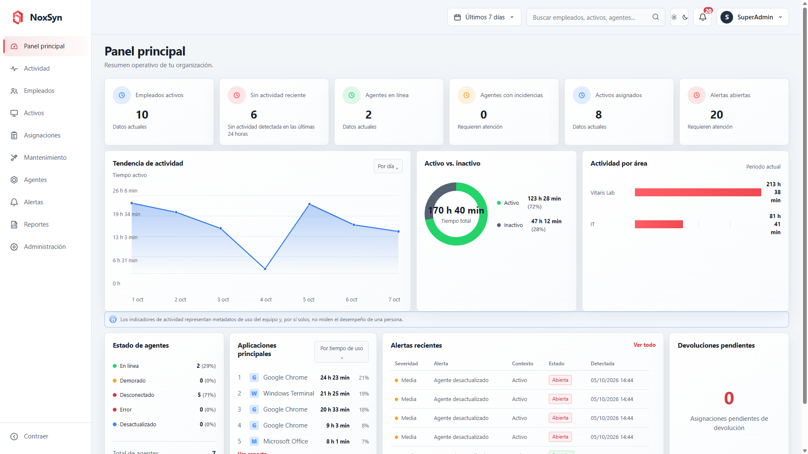
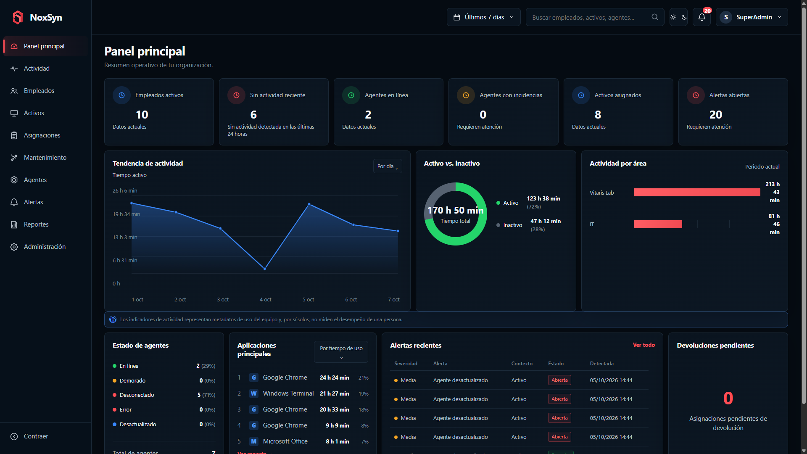

# ViewSyn Website


Modern SaaS website for **ViewSyn**, a technology management platform focused on operational visibility, asset management, monitoring, and business workflows.

This repository contains the public-facing website used to present the platform, its capabilities, dashboards, membership options, and contact flow.

> 🚧 **Project Status:** Active development

---

## About the Project

ViewSyn Website is designed as a modern and responsive product experience for potential customers and users.

The website presents the main capabilities of the ViewSyn platform through product information, real dashboard previews, membership options, contact flows, and access to the platform.

The project follows a component-based architecture using the **Next.js App Router**, **React**, and **TypeScript**.

---

## Features

- Responsive SaaS website
- Dark and Light modes
- Animated theme transitions
- Product feature presentation
- Real dashboard previews
- Membership plans
- Purchase / onboarding flow
- Contact form and API route
- Privacy notice
- Terms and conditions
- Environment-based platform access
- Responsive navigation
- Production-ready Next.js build

---

## Preview

### Light Mode



### Dark Mode



---

## Tech Stack

- **Next.js 16**
- **React 19**
- **TypeScript**
- **Tailwind CSS 4**
- **Lucide React**
- **ESLint**
- **Turbopack**
- **Git & GitHub**

---

## Application Routes

| Route | Description |
| --- | --- |
| `/` | Main landing page |
| `/funcionalidades` | Platform features |
| `/tableros` | Dashboard showcase |
| `/membresias` | Membership options |
| `/comprar` | Purchase and onboarding flow |
| `/contacto` | Contact page |
| `/privacidad` | Privacy notice |
| `/terminos` | Terms and conditions |
| `/api/contact` | Contact API endpoint |

---

## Environment Variables

Create a `.env.local` file based on `.env.example`:

```env
NEXT_PUBLIC_PLATFORM_URL=https://your-platform-url.example.com/login
